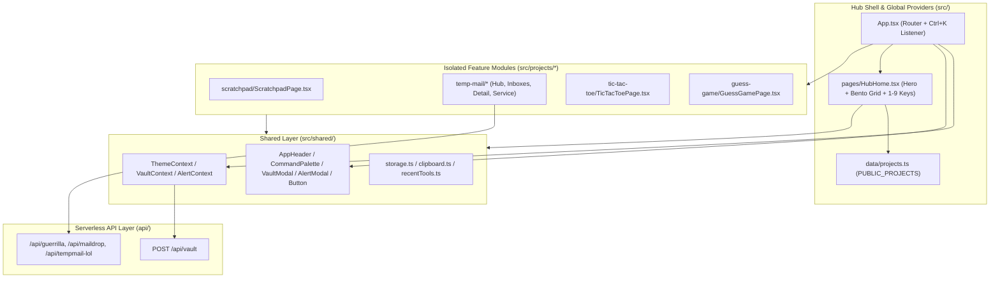

# Hub Architecture (`ANOUS-SPACE`)

This document explains how the `ANOUS-SPACE` host shell, shared UI/context primitives, isolated `src/projects/*` modules, and the `/api/vault` endpoint fit together.

---

## 1. System Interaction Diagram

---

## 2. Module Isolation Rule

To keep the repository maintainable as new utilities and games are added, `ANOUS-SPACE` enforces a strict architectural boundary:

1. **Self-Contained Modules**: Every internal micro-application lives inside `src/projects/<module-name>/` with its own views, helper services, and `README.md`.
2. **No Sibling Imports**: A module inside `src/projects/<module-a>/` must **never** import from `src/projects/<module-b>/`.
3. **Shared Layer Only**: Modules inside `src/projects/*` may import only from `src/shared/` (`AppHeader`, `Button`, `AlertContext`, `VaultContext`, `ThemeContext`, `storage`, `clipboard`, `recentTools`).

---

## 3. Hub Shell & Shared Contexts (`src/shared/`)

### `ThemeContext` (`src/shared/context/ThemeContext.tsx`)
- Manages the active visual theme (`'dark'` | `'light'`), persists selection in `localStorage['anous_theme']`, and synchronizes `document.documentElement.setAttribute('data-theme', theme)`.
- Toggled directly from the sun/moon icon button in `AppHeader`.

### `VaultContext` (`src/shared/context/VaultContext.tsx`) & `VaultModal` (`src/shared/ui/VaultModal.tsx`)
- Sends `POST /api/vault` with `{ password }`. Upon verification against server-side credentials, normalizes the returned private entries into `ProjectItem[]` objects under category `'Private'`.
- Persists `{ unlocked: true, projects }` in `window.sessionStorage['anous_vault_session']` so closing the browser tab automatically purges the session and locks the Vault.

### `AlertContext` (`src/shared/context/AlertContext.tsx`) & `AlertModal` (`src/shared/ui/AlertModal.tsx`)
- Exposes `useAlert().showAlert(title, message, actions)` for accessible confirmation and notification dialogs supporting `'default'`, `'cancel'`, and `'destructive'` action buttons.

### `CommandPalette` (`src/shared/ui/CommandPalette.tsx`) & Keyboard Shortcuts
- Global modal search toggled via `Ctrl+K` (`Cmd+K`) or the header `Search` button.
- Searches `PUBLIC_PROJECTS` (and `privateProjects` when unlocked) across titles, descriptions, categories, badges, and keywords.
- Typing `"vault"` surfaces a direct action row to unlock or manage the Private Vault.
- On `HubHome` (`/`), pressing number keys `1`–`9` (when no modal or input is focused) launches the corresponding visible card immediately.

### `AppHeader` (`src/shared/ui/AppHeader.tsx`)
- Renders the persistent top navigation bar across the Hub and all internal modules.
- Holding pointer press on `ANAS GAMAL` for **2000ms** triggers `openVaultModal()`, providing a clean touch-friendly way to access the Private Vault on mobile devices.

---

## 4. Theme & Design Tokens (`src/styles/global.css`)

All surfaces, borders, and typography tokens are defined as CSS custom properties on `:root` (`[data-theme='dark']`) and `[data-theme='light']`:

| Token | Dark Mode | Light Mode | Purpose |
| :--- | :--- | :--- | :--- |
| `--bg-app` | `#0E1015` | `#F8FAFC` | Main canvas with subtle dot-grid and radial top spotlight |
| `--bg-surface` | `#161922` | `#FFFFFF` | Card, modal, and panel surface |
| `--bg-elevated` | `#1C202B` | `#F1F5F9` | Highlighted list rows and elevated controls |
| `--border-subtle` | `#252A37` | `#E2E8F0` | Crisp `1px solid` structural borders |
| `--text-primary` | `#F3F4F6` | `#0F172A` | Primary headings and values |
| `--text-secondary` | `#9CA3AF` | `#475569` | Body copy and secondary labels |
| `--text-muted` | `#6B7280` | `#64748B` | Telemetry, shortcut badges, and timestamps |
| `--accent-tools` | `#3B82F6` | `#3B82F6` | Royal Blue accent for `Tools` cards and primary actions |
| `--accent-games` | `#10B981` | `#10B981` | Emerald accent for `Games` cards |
| `--accent-projects` | `#8B5CF6` | `#8B5CF6` | Violet accent for 2-column `Projects` showcase cards |
