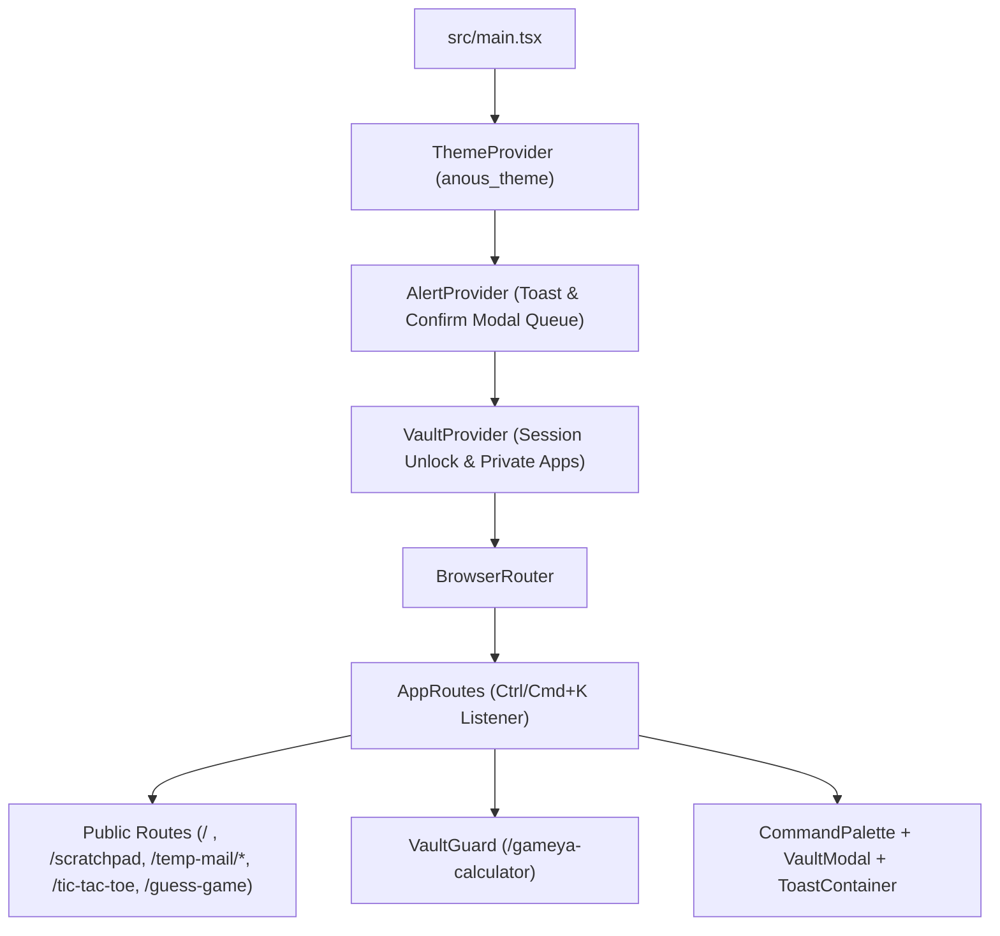
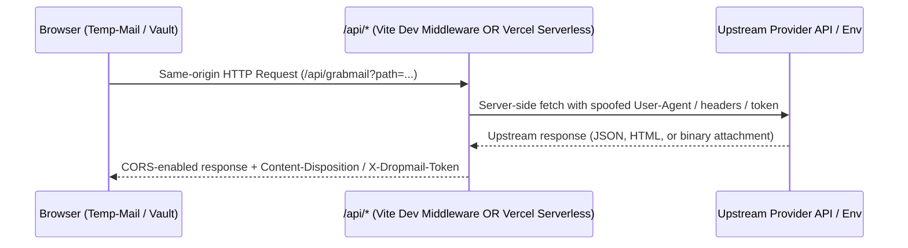

# ANOUS-SPACE Architecture Guide · دليل المعمارية البرمجية

This document provides a code-grounded architectural breakdown of **ANOUS-SPACE** in both English and Arabic. Every section directly reflects the implementation in `src/`, `api/`, and `vite.config.ts`.

---

## Part 1 — English Architecture Reference

### 1. Repository & Directory Structure

```text
ANOUS-SPACE/
├── api/                          # Vercel Serverless Functions (CORS & upstream API proxies)
│   ├── catchmail.ts              # Proxy -> https://api.catchmail.io/api/v1
│   ├── dropmail.ts               # Proxy -> https://dropmail.me/api/graphql/<af_token>
│   ├── grabmail.ts               # Proxy -> https://grabmail.io/api/v1
│   ├── guerrilla.ts              # Proxy -> https://api.guerrillamail.com/ajax.php
│   ├── inboxes.ts                # Proxy -> https://inboxes.com/api/v2
│   ├── tempmail-io.ts            # Proxy -> https://api.internal.temp-mail.io/api/v3
│   ├── tempmail-lol.ts           # Proxy -> https://api.tempmail.lol
│   ├── tempmail-plus.ts          # Proxy -> https://tempmail.plus/api
│   └── vault.ts                  # POST /api/vault authentication & private app registry
├── docs/
│   ├── ARCHITECTURE.md           # System architecture & technical internals
│   └── EXTENDING.md              # Step-by-step developer extension playbook
├── src/
│   ├── data/
│   │   └── projects.ts           # Public catalog (INTERNAL_TOOLS, EXTERNAL_PROJECTS) + route helpers
│   ├── pages/
│   │   └── HubHome.tsx           # Main workspace hub: search, category tabs, recent strip, project cards
│   ├── projects/                 # Self-contained mini-apps
│   │   ├── gameya-calculator/    # Private Vault-gated financial calculator (Rosca / Gameya + fund compounding)
│   │   ├── guess-game/           # Number guessing game (1–100) + useGuessGame hook
│   │   ├── scratchpad/           # Multi-tab markdown/plain-text scratchpad + useScratchpad hook
│   │   ├── temp-mail/            # 9-provider disposable email client (Hub, Inbox, Detail, adapters)
│   │   └── tic-tac-toe/          # Classic (Minimax AI / PvP) & 3-Marker FIFO Tic-Tac-Toe
│   ├── shared/
│   │   ├── context/              # Global React Contexts (ThemeContext, AlertContext, VaultContext)
│   │   ├── ui/                   # Reusable UI primitives & global modals
│   │   └── utils/                # Storage wrappers, clipboard helper, recent tools tracker
│   ├── styles/                   # Layered CSS design system
│   │   ├── tokens.css            # CSS custom properties (colors, fonts, spacing, shadows, accents)
│   │   ├── base.css              # Reset, typography, atmospheric background, animations, layout shell
│   │   ├── primitives.css        # Shared component styles (buttons, surfaces, modals, command palette)
│   │   ├── hub.css               # HubHome hero, search bar, recent strip, bento card grid
│   │   ├── scratchpad.css        # Scratchpad tab strip, editor textarea, status bar
│   │   ├── temp-mail.css         # Temp-Mail provider selector, composer, inbox rows, iframe viewer
│   │   ├── games.css             # Tic-Tac-Toe board & Guess Game layout
│   │   └── gameya-calculator.css # RTL Arabic layout & financial breakdown tables for Gameya Calculator
│   ├── App.tsx                   # Provider tree, global shortcuts, route definitions, VaultGuard
│   └── main.tsx                  # React DOM entry point & stylesheet imports
├── index.html                    # HTML shell + Google Fonts (Instrument Serif, Inter, JetBrains Mono)
├── vercel.json                   # SPA fallback rewrites (/((?!api/).*) -> /index.html)
└── vite.config.ts                # Vite config + local-api-dev-middleware mirroring api/*.ts
```

### 2. Application Lifecycle & Routing (`src/App.tsx`)



- **Route Table (`src/App.tsx`):**
  - `/` -> `HubHome`
  - `/scratchpad` -> `ScratchpadPage`
  - `/temp-mail` -> `TempMailHubPage`
  - `/temp-mail/inbox` -> `TempMailInboxPage`
  - `/temp-mail/detail` -> `EmailDetailPage`
  - `/tic-tac-toe` -> `TicTacToePage`
  - `/guess-game` -> `GuessGamePage`
  - `/gameya-calculator` -> Wrapped in `<VaultGuard>` -> `GameyaCalculatorPage`
  - `*` -> Redirects to `/` via `<Navigate to="/" replace />`
- **`VaultGuard` Protection:**
  - Checks `const { isUnlocked } = useVault()`.
  - If `isUnlocked` is `false`, any direct navigation to a guarded route (such as `/gameya-calculator`) immediately redirects to `/`.

### 3. Design System & CSS Token Architecture (`src/styles/`)

1. **`tokens.css`:**
   - **Theme Palettes:** Default `:root` defines the **Warm Obsidian Dark** palette (`--bg-canvas: #0E0E11`, `--bg-surface: #151519`, `--text-primary: #F4F1EC`). `[data-theme='light']` overrides tokens with the **Warm Stone Light** palette (`--bg-canvas: #F6F3EC`, `--bg-surface: #FFFFFF`, `--text-primary: #1C1917`).
   - **Typography:**
     - `--font-display`: `'Instrument Serif', Georgia, serif` (used for display titles and hero headings)
     - `--font-sans`: `'Inter', -apple-system, sans-serif` (body copy and UI controls)
     - `--font-mono`: `'JetBrains Mono', monospace` (addresses, counters, badges, and numerical telemetry)
   - **Per-Tool Accent Identities (`ToolAccent`):**
     - `terracotta` (`#D97757` dark / `#C25938` light) — Brand default & Scratchpad
     - `slate` (`#6B9FD4` dark / `#2B6CB0` light) — Temp-Mail Client
     - `ochre` (`#D9A441` dark / `#B7791F` light) — Tic-Tac-Toe
     - `sage` (`#68A87A` dark / `#2F855A` light) — Guess Game & Gameya Calculator
   - Applying `data-accent="<accent>"` on any container (`WorkspaceLayout`, `Surface`, `ToolBanner`, `HubCard`) dynamically remaps `--tool-accent`, `--tool-accent-subtle`, and `--tool-accent-border`.

2. **`base.css` & `primitives.css`:**
   - `.app-shell`, `.app-Atmosphere`, `.app-container`, and width modifiers (`.app-container--narrow`, `.app-container--medium`, `.app-container--wide`) establish the page frame.
   - `.animate-enter` uses `--stagger-index` to stagger card and section entry animations (`cubic-bezier(0.16, 1, 0.3, 1)`).

### 4. Shared UI Primitives (`src/shared/ui/`)

- **`WorkspaceLayout`:** Standard page wrapper for all mini-apps. Renders the atmospheric backdrop, `AppHeader`, breadcrumb back-navigation (`/` or parent route), main container with `data-accent`, and footer with `Ctrl + K` trigger.
- **`AppHeader`:** Sticky top bar displaying the `ANOUS` brand mark, optional current tool breadcrumb, Command Palette trigger (`Ctrl+K`), Vault status button (lock/unlock icon), and Theme toggle button.
- **`ToolBanner`:** Editorial header card at the top of each mini-app with custom `ToolEmblem`, eyebrow label, display title, description, and optional right-aligned action slot.
- **`ToolEmblem` & `getAccentBadgeTone`:** Renders bespoke SVG vector emblems for each `toolId` (`scratchpad`, `temp-mail`, `tic-tac-toe`, `guess-game`, `gameya-calc`, `ext-github`, etc.) and maps `ToolAccent` to `BadgeTone`.
- **`Surface`:** Polymorphic container (`div`, `section`, `article`, `button`) supporting `default`, `raised`, `recessed`, `ghost`, and `interactive` variants plus optional `accent` border highlights.
- **`Button`, `Input`, `Select`, `Badge`, `SegmentedControl`, `Modal`, `EmptyState`:** Standardized accessible controls styled via `primitives.css`.
- **`CommandPalette`:** Global keyboard-driven launcher (`Ctrl+K` / `Cmd+K`) indexing all internal tools, unlocked private apps, external portfolio projects, and quick workspace actions (toggle theme, lock/unlock vault).

### 5. Global Contexts (`src/shared/context/`)

#### A. `ThemeContext.tsx`
- Reads initial theme from `localStorage.getItem('anous_theme')` (defaults to `'dark'`).
- Synchronizes `document.documentElement.setAttribute('data-theme', theme)` and persists changes back to `localStorage`.

#### B. `AlertContext.tsx`
- Provides two non-blocking feedback channels:
  1. `showAlert(title, message, buttons?)`: Opens a modal dialog (single-alert acknowledgement or multi-button confirmation with `cancel` / `destructive` / `default` styles).
  2. `showToast({ title, message, type, durationMs, action })`: Appends a toast notification to the bottom-right `ToastContainer` with auto-dismissal (default `3800ms`) and optional action callback.

#### C. `VaultContext.tsx` & Serverless `/api/vault`
- Manages private app discovery and session-scoped authentication:
  - State (`isUnlocked`, `privateApps`, `isModalOpen`, `isLoading`, `error`) is held **strictly in React memory** (never persisted to `localStorage`), meaning a page reload or clicking "Lock" immediately clears private apps from memory.
  - `unlock(password)` sends `POST /api/vault` with `{ password }`.
  - The server compares `password` against `process.env.ADMIN_PASSWORD` (`'admin'` fallback in local Vite dev middleware) and returns `{ unlocked: true, apps: [...] }` combining built-in private apps (`gameya-calc` -> `/gameya-calculator`) with any JSON entries defined in `process.env.PRIVATE_APPS_JSON`.
  - `normalizePrivateApp()` converts raw server objects into typed `ProjectItem` records (`category: 'Private'`, `badge: 'Vault'`).

### 6. Dual Proxy Layer (`api/*.ts` & `vite.config.ts`)

Because third-party disposable email providers enforce strict CORS headers, custom `Origin`/`Referer` checks, or session tokens, frontend code communicates with same-origin `/api/*` endpoints that work identically in local development and Vercel production:



| Local & Serverless Endpoint | Upstream Target | Special Proxy Behavior |
| :--- | :--- | :--- |
| `/api/vault` | Environment (`ADMIN_PASSWORD`, `PRIVATE_APPS_JSON`) | Verifies password and returns private app descriptors. |
| `/api/grabmail` | `https://grabmail.io/api/v1${path}` | Forwards `Accept` and `Content-Disposition` for attachment downloads. |
| `/api/catchmail` | `https://api.catchmail.io/api/v1${path}` | Stateless query proxy (`?address=...`). |
| `/api/tempmail-io` | `https://api.internal.temp-mail.io/api/v3${path}` | Injects `Origin: https://temp-mail.io`, `Application-Name: webmail`, `Application-Version: 4.0.0`, preserves `@` in paths, and forwards body on `DELETE`. |
| `/api/inboxes` | `https://inboxes.com/api/v2${path}` | Proxies domain list, inbox activation, and message fetching. |
| `/api/tempmail-lol` | `https://api.tempmail.lol${path}` | Proxies TempMail.lol v3 inbox creation (`POST /v3/inboxes`) and polling (`GET /v3/inboxes?token=...`). |
| `/api/tempmail-plus` | `https://tempmail.plus/api${path}` | Proxies stateless inbox polling, detail lookup, delete, and attachment streaming. |
| `/api/dropmail` | `https://dropmail.me/api/graphql/${token}` | Automatically mints an `af_` token via `POST https://dropmail.me/api/token/generate` if missing or expired (`401`/`403`) and returns it in the `X-Dropmail-Token` header. |
| `/api/guerrilla` | `https://api.guerrillamail.com/ajax.php?...` | Query-string proxy forwarding `sid_token` and ajax function parameters (`f=...`). |

> [!NOTE]
> `mail.tm` (`https://api.mail.tm`) and `mail.gw` (`https://api.mail.gw`) support native browser CORS directly and are called from `src/projects/temp-mail/providers/mailtm.ts` without a proxy endpoint.

---

<div dir="rtl">

## الجزء الثاني — مرجع المعمارية البرمجية باللغة العربية

### 1. هيكلية المجلدات والملفات
تنقسم المنصة إلى ثلاث طبقات رئيسية:
1. **`api/` و `vite.config.ts` (طبقة الوسطاء الخلفية):** دوال Serverless خاصة بـ Vercel ومحاكيها المحلي داخل Vite لتجاوز قيود CORS وإدارة مصادقة الخزنة الخاصة (`/api/vault`).
2. **`src/shared/` و `src/styles/` (البنية التحتية المشتركة):** نظام التصميم الموحد، المكونات القياسية (`WorkspaceLayout`, `Surface`, `Button`, `CommandPalette`)، والسياقات العامة (`ThemeContext`, `AlertContext`, `VaultContext`).
3. **`src/projects/` و `src/pages/` (التطبيقات المصغرة والصفحة الرئيسية):** كل تطبيق مصغر معزول داخل مجلده الخاص في `src/projects/<tool-name>/` مع خطافاته البرمجية (Custom Hooks) ومكوناته الفرعية.

### 2. دورة حياة التطبيق والتوجيه (`src/App.tsx`)
- يتم تغليف التطبيق بالترتيب التالي: `ThemeProvider` ثم `AlertProvider` ثم `VaultProvider` ثم `BrowserRouter`.
- يستمع المكون `AppRoutes` لاختصار `Ctrl+K` / `Cmd+K` على مستوى النافذة لفتح وإغلاق لوحة الأوامر (`CommandPalette`).
- يقوم المكون الحارس `VaultGuard` بحماية المسارات الخاصة (مثل `/gameya-calculator`)؛ فإذا كانت الخزنة مقفلة (`isUnlocked === false`) يتم إعادة توجيه المستخدم فوراً إلى الصفحة الرئيسية `/`.

### 3. نظام التصميم ومتغيرات CSS (`src/styles/`)
- **`tokens.css`:** يحتوي على كافة متغيرات الألوان والخطوط والمسافات والظلال للوضع الداكن (`:root`) والوضع الفاتح (`[data-theme='light']`).
- **الهويات اللونية للأدوات (`ToolAccent`):**
  - `terracotta`: اللون الأساسي للمنصة وأداة المفكرة (`Scratchpad`).
  - `slate`: اللون المميز لأداة البريد المؤقت (`Temp-Mail`).
  - `ochre`: اللون المميز للعبة إكس-أو (`Tic-Tac-Toe`).
  - `sage`: اللون المميز للعبة تخمين الرقم (`Guess Game`) وحاسبة استثمار الجمعيات (`Gameya Calculator`).

### 4. السياقات العامة (Global Contexts)
1. **`ThemeContext`:** يدير التبديل بين الوضع الداكن والفاتح ويحفظ الاختيار في `localStorage` تحت المفتاح `anous_theme`.
2. **`AlertContext`:** يوفر دالة `showToast` للإشعارات السريعة أسفل الشاشة ودالة `showAlert` للنوافذ الحوارية التأكيدية.
3. **`VaultContext`:** يدير فتح الخزنة عبر إرسال كلمة المرور إلى `POST /api/vault`. يتم الاحتفاظ بحالة الفتح وقائمة التطبيقات الخاصة في الذاكرة العشوائية (React State) فقط دون حفظها في المتصفح لضمان أمان الجلسة عند التحديث أو القفل.

### 5. طبقة الوسطاء المزدوجة (`api/*.ts` و `vite.config.ts`)
لضمان عمل جميع مزودي البريد المؤقت التسعة في بيئة التطوير المحلية وبيئة الإنتاج على Vercel بنفس الكفاءة:
- أثناء تشغيل `npm run dev`، يعترض المكون الإضافي `local-api-dev-middleware` في `vite.config.ts` جميع الطلبات الموجهة إلى `/api/*` ويوجهها إلى المزود الأصلي مع إضافة الترويسات المطلوبة.
- في بيئة الإنتاج على Vercel، تتولى ملفات `api/*.ts` نفس المهمة كدوال Serverless مستقلة، مع إعداد `vercel.json` لتوجيه جميع المسارات غير المبدوءة بـ `/api/` إلى `index.html`.

</div>
