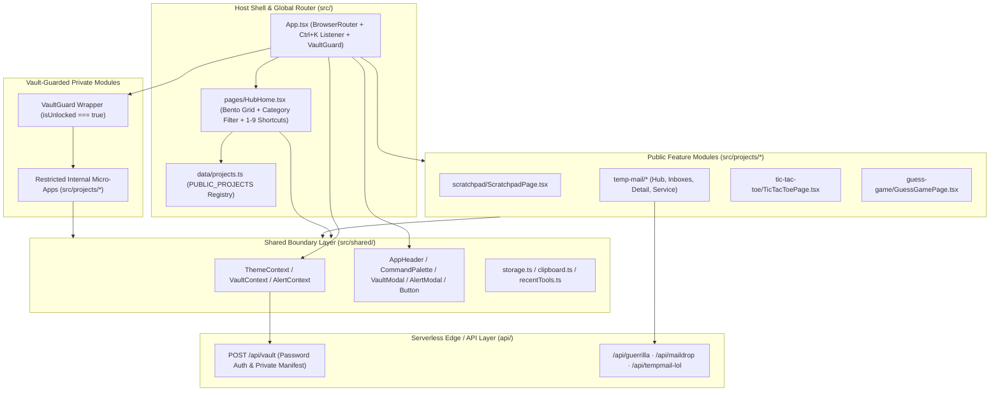

# Hub System Architecture (`ANOUS-SPACE`)

This document details how the `ANOUS-SPACE` host shell, shared UI and context layer (`src/shared/`), isolated micro-applications (`src/projects/*`), and serverless endpoints (`api/*`) interact.

---

## 1. System Topology

---

## 2. The Module Isolation Rule

To keep the repository clean and prevent cross-tool coupling as new utilities and games are mounted, `ANOUS-SPACE` enforces three non-negotiable rules:

1. **Self-Contained Feature Directories**: Every internal micro-application resides inside `src/projects/<module-name>/` with its own view components, domain services, and a dedicated `README.md`.
2. **Zero Sibling Imports**: A module in `src/projects/<module-a>/` must **never** import files, types, or helpers from `src/projects/<module-b>/`.
3. **Shared Layer Boundary Only**: Modules inside `src/projects/*` may import only from `src/shared/` (`AppHeader`, `Button`, `ThemeContext`, `AlertContext`, `VaultContext`, `storage`, `clipboard`, and `recentTools`).

> [!IMPORTANT]
> If two modules ever need the same utility or UI component, promote that primitive into `src/shared/ui/` or `src/shared/utils/` rather than importing across `src/projects/*` siblings.

---

## 3. Shared Contexts & UI Primitives (`src/shared/`)

| Primitive | File | Responsibility |
| :--- | :--- | :--- |
| **`ThemeContext`** | `src/shared/context/ThemeContext.tsx` | Manages `'dark'` and `'light'` themes, persists user preference in `localStorage['anous_theme']`, and updates `document.documentElement.setAttribute('data-theme', theme)`. |
| **`VaultContext`** | `src/shared/context/VaultContext.tsx` | Authenticates against `POST /api/vault`, normalizes returned private descriptors (supporting both external URLs and internal `/...` routes), and stores session state in `sessionStorage['anous_vault_session']`. |
| **`AlertContext`** | `src/shared/context/AlertContext.tsx` | Provides `useAlert().showAlert(title, message, actions)` for accessible modal alerts and destructive confirmations. |
| **`AppHeader`** | `src/shared/ui/AppHeader.tsx` | Persistent top navigation bar across the Hub and all modules; hosts the Dark/Light theme switcher, `Ctrl+K` Search button, active `Vault` lock pill, and the **2000ms long-press** Vault trigger on `ANAS GAMAL`. |
| **`CommandPalette`** | `src/shared/ui/CommandPalette.tsx` | Global `Ctrl+K` modal search indexing `PUBLIC_PROJECTS` (plus `privateProjects` when unlocked) and handling the `"vault"` command trigger. |

---

## 4. Private Vault & Guarded Internal Routes

`ANOUS-SPACE` supports two classes of Private Vault entries returned by `/api/vault`:
- **External Private Links (`type: 'external'`)**: Staging deployments or external dashboards that open in a new tab.
- **Guarded Internal Modules (`type: 'internal'`)**: Self-contained micro-apps inside `src/projects/<private-module>/` whose `url` or `to` begins with `/`:
  - Omitted from `PUBLIC_PROJECTS` in `src/data/projects.ts` so they never appear on the public Hub Home or Command Palette when locked.
  - Wrapped in `<VaultGuard>` inside `src/App.tsx`, which checks `useVault().isUnlocked` synchronously from `sessionStorage` and immediately redirects unauthorized direct URL visits to `/`.
  - Excluded from persistent `localStorage['anous_recent_tools']` so locked browsers retain zero trace of private module IDs.

---

## 5. Theme Tokens & Per-Route Atmospheres

While global CSS variables in `src/styles/global.css` define the Hub shell's base tokens, each internal workspace wraps its view in `.route-theme-canvas` to project a distinct visual identity:

| Workspace | Route | Dark Canvas | Light Canvas | Primary Accent |
| :--- | :--- | :--- | :--- | :--- |
| **Hub Home** | `/` | `#0B0F19` (Midnight Navy) | `#F4F6FA` (Warm Paper) | Category-Coded (`#3B82F6` / `#10B981` / `#8B5CF6` / `#F43F5E`) |
| **Quick Scratchpad** | `/scratchpad` | `#0D1117` (GitHub Obsidian) | `#F6F8FA` (Daylight IDE) | Electric Blue (`#3B82F6`) & Emerald (`#10B981`) |
| **Temp-Mail Suite** | `/temp-mail/*` | `#0F1322` (Indigo Slate) | `#F2F4FB` (Soft Indigo) | Provider-Coded (`#6366F1` / `#10B981` / `#F59E0B` / `#06B6D4`) |
| **Tic-Tac-Toe Arena** | `/tic-tac-toe` | `#13141B` (Charcoal Tabletop) | `#F4F4F7` (Warm Alabaster) | Sky-Blue `X` (`#38BDF8`) vs. Coral-Orange `O` (`#FB923C`) |
| **Number Guess** | `/guess-game` | `#0C1624` → `#241313` (Thermal) | `#EFF6FF` → `#FEF2F2` | Proximity-Reactive (`#38BDF8` → `#F59E0B` → `#FB7185` → `#10B981`) |
