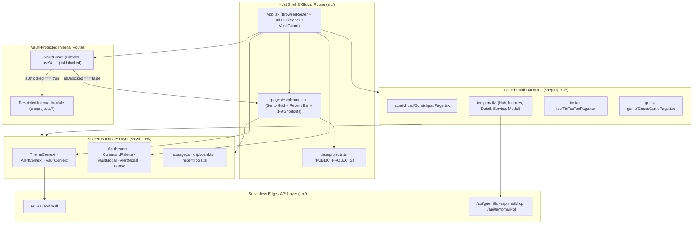

# Hub System Architecture (`ANOUS-SPACE`)

This document specifies the verified runtime architecture of `ANOUS-SPACE`, covering the host router (`src/App.tsx`), the shared UI/context boundary (`src/shared/`), isolated feature modules (`src/projects/*`), and the serverless API layer (`api/*`).

---

## 1. System Interaction Diagram

---

## 2. The Module Isolation Rule

To ensure modules can be added, refactored, or removed without side effects across the rest of the workspace, `ANOUS-SPACE` enforces three architectural rules:

1. **Self-Contained Directories**: Every internal micro-application lives in `src/projects/<module-name>/` with its own React views, helper services, and module `README.md`.
2. **No Cross-Module Imports**: A file inside `src/projects/<module-a>/` must **never** import from `src/projects/<module-b>/`.
3. **Shared Layer Boundary Only**: Modules inside `src/projects/*` may import only from `src/shared/` (`AppHeader`, `Button`, `AlertModal`, `ThemeContext`, `AlertContext`, `VaultContext`, `storage`, `clipboard`, and `recentTools`).

> [!IMPORTANT]
> Cross-cutting primitives belong exclusively in `src/shared/`. Never import state or components directly between sibling directories under `src/projects/`.

---

## 3. Shared Contexts, UI Primitives & Utilities (`src/shared/`)

| File | Exported Symbols | Verified Implementation Details |
| :--- | :--- | :--- |
| `src/shared/context/ThemeContext.tsx` | `ThemeProvider`, `useTheme`, `ThemeMode` | Hydrates `'dark'` \| `'light'` synchronously from `localStorage['anous_theme']`, applies `data-theme` on `document.documentElement`, and exposes `toggleTheme()` and `setTheme()`. |
| `src/shared/context/VaultContext.tsx` | `VaultProvider`, `useVault` | Hydrates `{ unlocked, projects }` synchronously from `sessionStorage['anous_vault_session']`. `unlockVault(password)` sends `POST /api/vault` and normalizes returned items into `ProjectItem[]` (`category: 'Private'`), treating paths starting with `/` as internal routes. |
| `src/shared/context/AlertContext.tsx` | `AlertProvider`, `useAlert` | Manages modal state for `AlertModal` and exposes `showAlert(title, message?, actions?)`. |
| `src/shared/ui/AppHeader.tsx` | `AppHeader` | Renders the top navigation bar, back-to-hub button on child routes, **2000ms pointer hold timer** (`startPress`) on `ANAS GAMAL` to open `VaultModal`, active Rose `#F43F5E` `Vault` status pill when unlocked, theme toggle button, and `Search` (`Ctrl K`) button. |
| `src/shared/ui/CommandPalette.tsx` | `CommandPalette` | Global search modal (`zIndex: 1100`). Searches `PUBLIC_PROJECTS` (plus `privateProjects` when unlocked), supports `ArrowUp`/`ArrowDown`/`Enter`/`Escape`, and surfaces the Vault action row when the query equals `"vault"`. |
| `src/shared/ui/VaultModal.tsx` | `VaultModal` | Password authentication dialog (`zIndex: 1150`) when locked, or session status + `Lock Vault` confirmation when unlocked. |
| `src/shared/ui/AlertModal.tsx` | `AlertModal`, `AlertAction` | Accessible dialog (`zIndex: 1200`) mapping action styles `'default'`, `'cancel'`, and `'destructive'` to `Button` variants. |
| `src/shared/ui/Button.tsx` | `Button`, `ButtonProps` | Shared button primitive supporting variants `'primary'`, `'secondary'`, `'ghost'`, and `'danger'`, sizes `'sm'`, `'md'`, `'lg'`, `fullWidth`, and inline `loading` spinner. |
| `src/shared/utils/storage.ts` | `getItem`, `setItem`, `getItemAsync`, `setItemAsync`, `deleteItemAsync` | Safe synchronous and asynchronous wrappers around `window.localStorage` with `try/catch` guards. |
| `src/shared/utils/clipboard.ts` | `copyText`, `setStringAsync`, `copyToClipboard` | Writes to `navigator.clipboard.writeText` with a hidden `<textarea>` + `document.execCommand('copy')` fallback. |
| `src/shared/utils/recentTools.ts` | `getRecentProjectIds`, `recordRecentProject` | Maintains a deduplicated FIFO list of up to `3` (`MAX_RECENT = 3`) public internal project IDs in `localStorage['anous_recent_tools']`. |

---

## 4. Private Vault Flow & Route Protection

1. **Serverless Verification (`POST /api/vault`)**:
   - `api/vault.ts` compares the submitted `{ password }` against `process.env.ADMIN_PASSWORD` (returning `503` if unconfigured or `401` on mismatch).
   - On success, merges built-in private route descriptors with any JSON array configured in `process.env.PRIVATE_APPS_JSON` and returns `{ unlocked: true, apps }`.
2. **Client Normalization & Session Scope**:
   - `VaultContext` normalizes each app: if `app.to` is defined or `app.url` begins with `/`, it sets `type: 'internal'` and `to: rawTarget`; otherwise it sets `type: 'external'`.
   - Stored in `window.sessionStorage['anous_vault_session']` so closing the browser tab automatically purges the unlocked state.
3. **Route Guard (`<VaultGuard>` in `src/App.tsx`)**:
   - Private internal routes are wrapped in `<VaultGuard>`, which reads `useVault().isUnlocked`. Any direct navigation to a guarded URL while `isUnlocked === false` immediately renders `<Navigate to="/" replace />`.
   - Both `HubHome` and `CommandPalette` skip `recordRecentProject` when `item.category === 'Private'`, ensuring private module IDs are never written to persistent `localStorage`.

---

## 5. Global Design Tokens & Route Atmospheres (`src/styles/global.css`)

| CSS Token / Surface | Dark Mode (`[data-theme='dark']`) | Light Mode (`[data-theme='light']`) | Usage |
| :--- | :--- | :--- | :--- |
| `--bg-app` | `#0B0F19` | `#F4F6FA` | Hub Home midnight-navy / warm paper canvas with dot-grid & radial spotlights |
| `--bg-surface` | `#131929` | `#FFFFFF` | Elevated cards, modals, and header buttons |
| `--bg-elevated` | `#1C253B` | `#EDF1F7` | Active command palette rows and hover states |
| `--bg-input` | `#0D121F` | `#EEF2F8` | Input fields and modal header/footer bars |
| `--border-subtle` | `#222B40` | `#DCE2EE` | Crisp `1px solid` structural borders |
| `--text-primary` | `#F3F4F6` | `#0F172A` | Primary headings and values |
| `--text-secondary` | `#9CA3AF` | `#475569` | Descriptions and secondary labels |
| `--text-muted` | `#6B7280` | `#64748B` | Keyboard badges, timestamps, and metadata |
| `--accent-tools` | `#3B82F6` | `#3B82F6` | Electric Blue accent for `Tools` cards and primary buttons |
| `--accent-games` | `#10B981` | `#10B981` | Emerald accent for `Games` cards |
| `--accent-projects` | `#8B5CF6` | `#8B5CF6` | Violet accent for 2-column `Projects` showcase cards |
| `--accent-vault` | `#F43F5E` | `#F43F5E` | Rose accent for `Private` Vault tab, badges, and header indicator |
